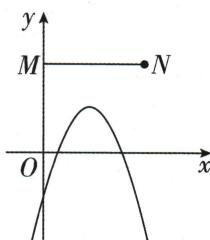

<!-- question-source:start -->
2[2025 山东临沂期中, 中]如图, 已知抛物线 $y = -x^{2} + 4x - 2$ 和线段 MN, 点 M 和点 N 的坐标分别为 $(0, 4)$ , $(5, 4)$ , 将抛物线向上平移 $k (k > 0)$ 个单位

长度后与线段 MN 仅有一个交点, 则 k 的取值范围是 \_\_\_\_.
<!-- question-source:end -->

![[Q00107172A1]]
