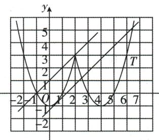
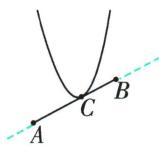
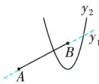
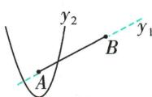

> [!success]- 必刷题
>
> > [!success] **【答案】** A
>
> > [!note]- **【解析】**
> > ∵ 抛物线 $C_{1}: y = x^{2} - 1$ ，将 $C_{1}$ 向右平移 4 个单位长度，得到抛物线 $C_{2}$ ，∴ 抛物线 $C_{2}$ 的解析式为 $y = (x - 4)^{2} - 1$ .
> > 联立得 $\left\{\begin{aligned}y&=x^{2}-1,\\ y&=(x-4)^{2}-1,\end{aligned}\right.$ 解得 $\left\{\begin{aligned}x&=2,\\ y&=3,\end{aligned}\right.$
> >
> > ∴ 两抛物线的交点坐标为(2,3). 由题意得图形 T 如图所示. 把(2,3)代入 $y = x + n$ , 得 3 = 2 + n, 解得 n = 1.
> >
> > ## 思路分析
> >
> > 
> >
> > 当直线 $y = x + n$ 与 $C_1$ 只有一个交点时， $x + n = x^2 - 1$ ，即 $x^2 - x - 1 - n = 0$ 有两个相等的实数根，
> >
> > 求得平移后的抛物线的解析式,两解析式联立,求得两抛物线交点坐标为(2,3),由题意画图形T,再采用数形结合思想解题即可.
> >
> > $\therefore \Delta=1-4\times1\times(-n-1)=0,$ 解得 $n=-\frac{5}{4}.$ ∵ 直线 $y=x+n$ 与图形 T 恰好有 4 个交点, ∴ 结合图形可知, $-\frac{5}{4}<n<1.$ 故选 A.
> >
> > 大招解读 | 端点值代入法
> > (1) 确定由抛物线和线段所在直线的解析式得到的方程；
> > (2) 抛物线与线段 AB 仅有一个交点 C 时：
> > 情况 1: 如图 (1), 满足条件 $\Delta = 0$ 且 $x_{A} < x_{C} < x_{B}$ .
> >
> > 
> >
> > 
> > 图(1)
> > 图(2)
> >
> > 
> > 图(3)
> >
> > 情况2：如图(2)，满足条件 $\Delta >0$ 且 $x = x_{B}$ 时， $y_{1} \geqslant y_{2}; x = x_{A}$ 时， $y_{2} > y_{1}$ .
> > 情况3：如图(3)，满足条件 $\Delta >0$ 且 $x = x_{B}$ 时， $y_{2} > y_{1}; x = x_{A}$ 时， $y_{1} \geqslant y_{2}$ .
