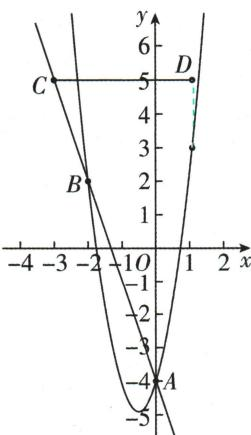
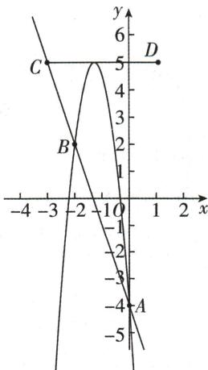

> [!success]- 必刷题
>
> > [!success] **【答案】** 详见解析
>
> > [!note]- **【解析】**
> > 【解】设直线 $AB$ 的解析式为 $y = kx + n (k \neq 0)$ . 把点 $A(0, -4)$ 和 $B(-2, 2)$ 代入得 $\left\{ \begin{array}{l} n = -4, \\ -2k + n = 2, \end{array} \right.$ 解得 $\left\{ \begin{array}{l} k = -3, \\ n = -4, \end{array} \right.$ ∴ 直线 $AB$ 的解析式为 $y = -3x - 4$ . 把 $C(m, 5)$ 代入, 得 $m = -3$ , ∴ $C(-3, 5)$ , 由平移得 $D(1, 5)$ . ∵ 二次函数 $y = ax^2 + bx + c$ 的图象经过点 $A(0, -4)$ 和 $B(-2, 2)$ , ∴ $\left\{ \begin{array}{l} c = -4, \\ 4a - 2b + c = 2, \end{array} \right.$ 解得 $\left\{ \begin{array}{l} c = -4, \\ b = 2a - 3, \end{array} \right.$ ∴ $y = ax^2 + (2a - 3)x - 4$ . ①当 $a > 0$ 时, 若抛物线与线段 $CD$ 只有一个公共点, 如图(1), 则抛物线上的点 $(1, a + 2a - 3 - 4)$ 在 $D$ 点的下方, ∴ $a + 2a - 3 - 4 < 5$ , 解得 $a < 4$ , ∴ $0 < a < 4$ ;
> >
> > 
> > 图(1)
> >
> > 
> > 图(2)
> > - **②**：当 a<0 时, 若抛物线的顶点在线段 CD 上, 则抛物线与线段 CD 只有一个公共点. 如图 (2), $\therefore \frac{4ac-b^{2}}{4a}=5$ , 即 $\frac{4a\times(-4)-(2a-3)^{2}}{4a}=5$ ,解得 $a=-3+\frac{3}{2}\sqrt{3}$ 或 $a=-3-\frac{3}{2}\sqrt{3}$ .
> > 综上，a 的取值范围是 0 < a < 4 或 $a = -3 \pm \frac{3}{2} \sqrt{3}$ .
