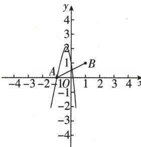
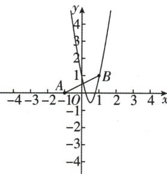

> [!success]- 必刷题
>
> > [!success] **【答案】** $m \leqslant -2$ 或 $1 \leqslant m < \frac{9}{8}$
>
> > [!note]- **【解析】**
> > - **①**：如图(1)，当
> > m<0 时，抛物线对称轴为直线 $x=\frac{1}{2m}<0$ ∴ x = -1 时， $y = mx^{2} - x + 1 = m + 1 + 1 \leqslant 0$ ，解得 $m \leqslant -2, \therefore m \leqslant -2.$
> >
> > 思路分析
> > 把 A, B 的坐标分别代入抛物线解析式得到关于 t 的方程, 解方程求得 t 的值, 结合图象即可得到符合题意的 t 的取值范围.
> >
> > 
> >
> > 
> > 图(1)
> > 图(2)
> > - **②**：如图(2)，当 m>0 时，∵ 点 A(-1,0)，B(1,1)，设直线 AB 的解析式为 $y=kx+b$ ，
> > ∴ $\left\{\begin{aligned}-k+b=0,\\ k+b=1,\end{aligned}\right.$ 解得 $\left\{\begin{aligned}k=\frac{1}{2},\\ b=\frac{1}{2},\end{aligned}\right.$ ∴ 直线 AB 的解析式为 $y=\frac{1}{2}x+\frac{1}{2}$ . 令 $\frac{1}{2}x+\frac{1}{2}=mx^{2}-x+1$ ，整理得 $mx^{2}-\frac{3}{2}x+\frac{1}{2}=0$ . ∵ 二次函数 $y=mx^{2}-x+1$ 的图象与线段 AB 有两个不同的交点，∴ $\Delta=\left(-\frac{3}{2}\right)^{2}-4m\times\frac{1}{2}>0$ ，且 x=1 时， $y=mx^{2}-x+1=m-1+1\geqslant1$ ，∴ $1\leqslant m<\frac{9}{8}$ .
> > 综上，m 的取值范围为 $m \leqslant -2$ 或 $1 \leqslant m < \frac{9}{8}$ .
