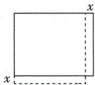
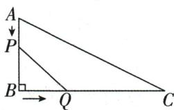

<!-- question-source:start -->
1 [2025 安徽六安期中] 如图所示是一个长 20 m、宽 16 m 的矩形花园, 现重建花园, 将它的长缩短 x m、宽增加 x m, 要想使重建后的花园面积最大, 则 x 应为 ( )
A. 1 B. 1.5 C. 2 D. 4

(第1题图)

(第2题图)
<!-- question-source:end -->

![[Q00107183A1]]
