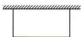
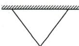
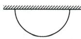

<!-- question-source:start -->
3 九年级(2)班计划在劳动实践基地内种植蔬菜,班长买回来8米长的围栏,准备围成一边靠墙(墙足够长)的菜园,为了让菜园面积尽可能大,同学们提出了围成矩形、等腰三角形(底边靠墙)和半圆形这三种方案,如图,其中最佳方案是()

方案1

方案2
方案3

A.方案1 B.方案2C.方案3 D.方案1或方案2
<!-- question-source:end -->

![[Q00107185A1]]
