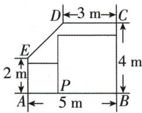
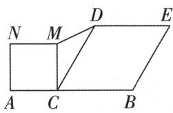

<!-- question-source:start -->
4[2024 安徽滁州校级期中]现有一张五边形的钢板 ABCDE 如图所示, $\angle A = \angle B = \angle C = 90^{\circ}$ , 在 AB 边上取一点 P, 分别以 AP, BP 为边各剪下一个正方形钢板模型,所剪得的两个正方形面积和最大为\_\_\_\_m².

(第4题图)
(第5题图)
<!-- question-source:end -->

![[Q00107186A1]]
