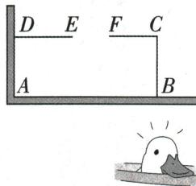

<!-- question-source:start -->
6[2024 广东珠海校级期中]如图,某小区计划用 18 m 的铁栅栏两面靠墙(墙足够长)围成一个矩形车棚 ABCD,为了方便存车,在 CD (CD > 2 m) 边上开了一个 2 m 宽的门 EF(门不是用铁栅栏做成的),设边 BC 的长为 x m,车棚面积为 $y \, m^{2}$ .

(1) 求 y 与 x 之间的函数关系式,并直接写出自变量 x 的取值范围;

(2) 当 x 的值是多少时,车棚面积最大? 最大面积是多少?

小心有坑
<!-- question-source:end -->

![[Q00107188A1]]
