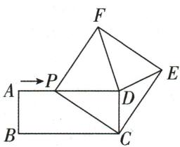
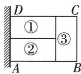

<!-- question-source:start -->
1[2025 浙江绍兴质检, 中]如图, 矩形 ABCD 中, AB = 2 cm, AD = 5 cm, 动点 P 从点 A 出发, 以 1 cm/s 的速度沿 AD 向终点 D 移动, 设移动时间为 t s. 连接 PC, 以 PC 为一边作正方形 PCEF, 连接 DE, DF, 则 $\triangle DEF$ 面积的最小值为 ( )
A. $\frac{3}{2}$ cm $^{2}$ B. $\frac{3}{4}$ cm $^{2}$ C. $\frac{4}{5}$ cm $^{2}$ D. $\frac{8}{5}$ cm $^{2}$

(第1题图)

(第2题图)
<!-- question-source:end -->

![[Q00107189A1]]
