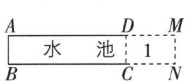
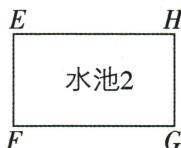
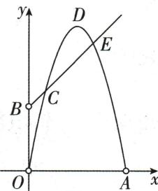

<!-- question-source:start -->
3 核心素养模型观念 [较难]【生活情境】

为美化校园环境,某学校根据地形情况,要对景观带中一个长 $AD = 4 \, m$ , 宽 $AB = 1 \, m$ 的长方形水池 ABCD 进行加长改造(如图(1), 改造后的水池 ABNM 仍为长方形, 以下简称水池 1), 同时, 再建造一个周长为 $12 \, m$ 的矩形水池 EFGH (如图(2), 以下简称水池 2), 且 EF = DM.

图(1)

图(2)

【建立模型】

设水池 ABCD 的边 AD 的加长长度 DM 为 $x \, m$ (x > 0)，加长后水池 1 的总面积为 $y_{1} \, m^{2}$ ，则 EF = x $m, y_{1}$ 关于 x 的函数解析式为 $y_{1} = x + 4 (x > 0)$ ；设水池 2 的面积为 $y_{2} \, m^{2}$ ，则 $y_{2}$ 关于 x的函数解析式为 $y_{2} = -x^{2} + 6x (0 < x < 6)$ ，上述两个函数在同一平面直角坐标系中的图象如图(3).
【问题解决】

(1) 若水池 2 的面积随 EF 长度的增加而减小, 则 EF

图(3)

长度的取值范围是\_\_\_\_（可省略单位），水池2面积的最大值是\_\_\_\_ $m^{2}$ ;

(2)在图(3)字母标注的点中,表示两个水池面积相等的点是\_\_\_\_,此时x的值是\_\_\_\_;

(3) 当水池 1 的面积大于水池 2 的面积时, x 的取值范围是 \_\_\_\_;

(4) 在 1 < x < 4 范围内, 求两个水池面积差的最大值和此时 x 的值;

(5) 假设水池 ABCD 的边 AD 的长度为 b m, 其他条件不变 (这个加长改造后的新水池简称水池 3), 则水池 3 的总面积 $y_{3}(\mathrm{m}^{2})$ 关于 x(m) (x > 0) 的函数解析式为 $y_{3} = x + b (x > 0)$ . 当水池 3 与水池 2 的面积相等时, x 有唯一值, 求 b 的值.
<!-- question-source:end -->

![[Q00107191A1]]
