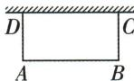
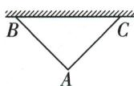

> [!success]- 必刷题
>
> > [!success] **【答案】** C
>
> > [!note]- **【解析】**
> > 如图. 方案 1: 设 AD = x 米, 则 $AB = (8 - 2x)$ 米, 则菜园的面积为 $x(8 - 2x) = -2x^{2} + 8x = -2(x - 2)^{2} + 8$ . ∵ -2 < 0, ∴ 当 x = 2 时, 菜园有最大面积, 为 8 平方米.
> >
> > 
> > 方案1
> >
> > 方案2: 当 $\angle BAC = 90^{\circ}$ 时, 菜园有最大面积, 为 $\frac{1}{2} \times 4 \times 4 = 8$ (平方米).
> >
> > 
> > 方案2
> >
> > 方案3: 半圆的半径为 $\frac{8}{\pi}$ ，此时菜园的面积为 $\frac{\pi\times\left(\frac{8}{\pi}\right)^{2}}{2}=\frac{32}{\pi}$ （平方米）.∵ $\frac{32}{\pi}>8$ ,∴最佳方案是方案3.
> >
> > 故选 **C**.
