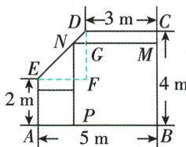

> [!success]- 必刷题
>
> > [!success] **【答案】** 14
>
> > [!note]- **【解析】**
> > 如图, 过 D 作 $DF \parallel BC$ , 交 MN 于 G, 过 E 作 $EF \perp DF$ 于 F, 则 EF = DF = 2, ∴ $\triangle DEF$ 是等腰直角三
> >
> > 
> >
> > 思路分析
> > 根据三个矩形面积相等, 得到矩形 AEFD 面积是矩形 BCFE 面积的 2 倍, 可得出 AE = 2BE. 设 BC = x m, BE = a m, 则 AE = 2a m, 用含 x 的代数式表示出 a 与 3a, 进而表示出矩形区域 ABCD 的面积 S 与 x 之间的关系式, 并求出 x 的取值范围, 再利用二次函数的性质求出面积 S 取最大值时 x 的值.
> >
> > 角形. 设 $PB = x \mathrm{~m}$ , 所剪得的两个正方形面积和为 $S \mathrm{~m}^2$ , 则 $NG = DG = x - 3$ , 则 $BM = BC - CM = BC - DG = 4 - (x - 3) = 7 - x$ . 由 $BM = BP$ 得 $7 - x = x, \therefore x = 3.5, \therefore 3 \leqslant x \leqslant 3.5, S = (5 - x)^2 + x^2 = 2x^2 - 10x + 25 = 2(x - 2.5)^2 + 12.5$ , 当 $x = 3.5$ 时, $S$ 有最大值, 此时 $S = 2 \times (3.5 - 2.5)^2 + 12.5 = 14.5$ , 故答案为 14.5.
