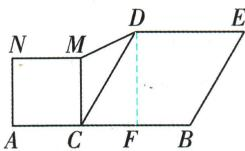

> [!success]- 必刷题
>
> > [!success] **【答案】** 4
>
> > [!note]- **【解析】**
> > 如图, 过点 D 作 $DF \perp BC$ 于 F. 设 AC = x, 则 BC = 8 - x. ∵ 四边形 BCDE 为菱形, $\angle E =$
> >
> > 
> >
> > $60^{\circ}, \therefore CD = BC = 8 - x, \angle DCF = \angle E = 60^{\circ},$ $\therefore CF = \frac{1}{2} CD = \frac{1}{2}(8 - x)$ , 则 $S_{\triangle CDM} = \frac{1}{2} x \times \frac{1}{2}(8 - x) = -\frac{1}{4}(x - 4)^{2} + 4, \therefore \triangle CDM$ 面积的最大值为 4, 故答案为 4.
