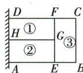

> [!success]- 必刷题
>
> > [!success] **【答案】** $15\mathrm{m}
>
> > [!note]- **【解析】**
> > 如图, ∵ 三块矩形区域的面积相等, ∴ 矩形 AEFD 面积是矩形 BCFE 面积的 2 倍, ∴ AE = 2BE. 设 BC = x m, BE = FC = a m, 则 AE = HG = DF = 2a m.
> > ∵ DF + FC + HG + AE + EB + EF + BC = 60 m, ∴ 8a + 2x = 60, ∴ a = -\frac{1}{4}x + \frac{15}{2}, 3a = -\frac{3}{4}x + \frac{45}{2}, ∴ 矩形区域 ABCD 的面积 S = (-\frac{3}{4}x + \frac{45}{2})x = -\frac{3}{4}x^2 +$\frac{45}{2} x.\because a = -\frac{1}{4} x + \frac{15}{2} >0,\therefore x <   30,\therefore S = -\frac{3}{4} x^2+$ $\frac{45}{2} x(0 <   x <   30). \because$ 二次项系数 $-\frac{3}{4} <  0,\therefore$ 当 $x = -\frac{\frac{45}{2}}{2\times\left(-\frac{3}{4}\right)} = 15$ 时， $S$ 有最大值.故答案为 $15\mathrm{m}.$
> >
> > 
> >
> > ## 刷素养·
