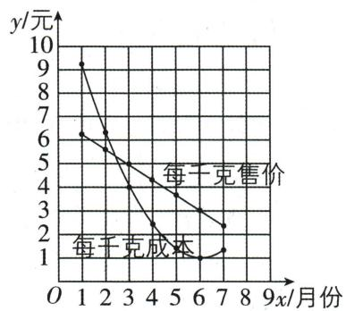

<!-- question-source:start -->
3 在 1\~7 月份, 某地的蔬菜批发市场指导菜农生产和销售某种蔬菜, 并向他们提供了这种蔬菜每千克售价与每千

克成本的信息如图所示,则出售该种蔬菜每千克利润最大的月份可能是 ( )
A.1 月份 B.2 月份 C.5 月份 D.7 月份
<!-- question-source:end -->

![[Q00107194A1]]
