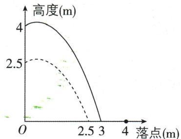

<!-- question-source:start -->
3 如图,水池中心点 O 处竖直安装一水管,水管喷头喷出抛物线形水柱,喷头上下移动时,抛物线形水柱随之竖直上下平移,水柱落点与点 O 在同一水平面. 安装师傅调试发现,喷头高 2.5 m 时,水柱落点距 O 点 2.5 m;喷头高 4 m 时,水柱落点距 O 点 3 m,那么喷头高\_\_\_\_m 时,水柱落点距 O 点 4 m.

<!-- question-source:end -->

![[Q00107199A1]]
