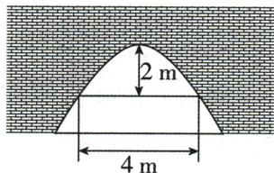

<!-- question-source:start -->
4 如图,有一抛物线形拱桥,当拱顶离水面 2 m 时,水面宽 4 m,当水面宽增加 $(2\sqrt{6}-4)$ m 时,

水面应下降的高度是

A. $2\mathrm{m}$ B. $1\mathrm{m}$ C. $\sqrt{6}\mathrm{m}$ D. $(\sqrt{6} -2)\mathrm{m}$
<!-- question-source:end -->

![[Q00107200A1]]
