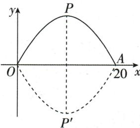

<!-- question-source:start -->
5[2025 河北石家庄校级期中]某拱桥的主桥拱可近似地看作抛物线, 桥拱在水面的跨度 OA 约为 20 米, 若按如图所示方式建立平面直角坐标系, 则主桥拱所在抛物线可以表示为 $y = a(x - 10)^2 + 10$ , 则 $a =$ \_\_\_\_, 主桥拱最高点 P 与其在水中倒影点 $P'$ 之间的距离为 \_\_\_\_ 米.

<!-- question-source:end -->

![[Q00107201A1]]
