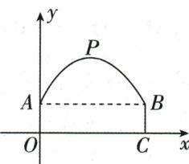

<!-- question-source:start -->
6 一座隧道的截面由抛物线和长方形构成,长方形的长 OC 为 8 m, 宽 OA 为 2 m, 隧道最高点 P 位于 AB 的中央且距地面 6 m, 建立如图所示的坐标系 (1 个单位长度表示 1 m).

(1) 求抛物线的解析式;

(2) 一辆货车高 4 m, 宽 2 m, 能否从该隧道内通过? 为什么?

(3) 如果隧道内设双行道, 两辆同样的上述货车相对而行, 是否可以同时在隧道内顺利通过? 为什么?

是个新“烤”鸭

电子错题本鸭
<!-- question-source:end -->

![[Q00107202A1]]
