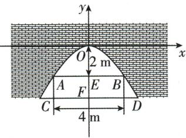

> [!success]- 必刷题
>
> > [!success] **【答案】** B
>
> > [!note]- **【解析】**
> > 如图,以拱桥桥顶为坐标原点,1 m 为 1 个单位长度,建立平面直角坐标系 xOy, AB 与 y 轴交于点 E,水面下降后宽度为 CD,与 y 轴交于点 F.∵ OE=2 m,AB=4 m,抛物线
> >
> > ## 易错警示
> >
> > 在求解过程中涉及的点的纵坐标都为负数时, 注意距离和坐标之间的关系, 以防出错.
> >
> > 的对称轴为 y 轴，
> > ∴ 点 $B(2, -2)$ . 设抛物线的解析式为 $y = ax^{2}$ . ∵ 抛物线过点 B, ∴ -2 = 4a, ∴ $a = -\frac{1}{2}$ ,
> >
> > 
> >
> > ∴ 抛物线解析式为 $y = -\frac{1}{2}x^{2}$ . 设水面应下降的高度是 n m. ∵ $CD = AB + (2\sqrt{6} - 4) = 4 + (2\sqrt{6} - 4) = 2\sqrt{6} \, (\text{m})$ , ∴ $D(\sqrt{6}, -2 - n)$ . ∵ 点 D 在抛物线上, ∴ $-2 - n = -\frac{1}{2} \times (\sqrt{6})^{2}$ , 解得 n = 1.
> >
> > 故选 **B**.
