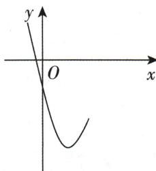

<!-- question-source:start -->
7[2024 陕西渭南期末]如图, 在平面直角坐标系中,二次函数 $y = ax^{2} + bx + c (a > 0)$ 的部分图象如图所示,其对称轴为直线 $x = 2$ ,与 $y$ 轴交于

点 $(0,-2)$ ，则当y<-2时，x的取值范围是\_\_\_\_.
<!-- question-source:end -->

![[Q00106638A1]]
