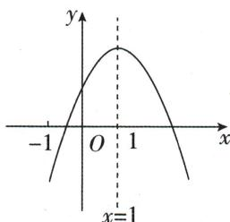
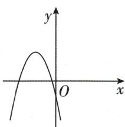

<!-- question-source:start -->
9 二次函数 $y = ax^2 + bx + c$ 的图象如图所示, 对称轴是直线 $x = 1$ . 下列结论: ① $abc < 0$ ; ② $3a + c > 0$ ; ③ $(a + c)^2 - b^2 < 0$ ; ④ $a + b \leqslant m(am + b)$ ( $m$ 为实数). 其中结论正确的个数为 ( )
A. 1 B. 2 C. 3 D. 4

(第9题图)
(第 10 题图)
<!-- question-source:end -->

![[Q00106640A1]]
