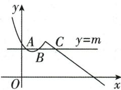

<!-- question-source:start -->
5[2024 湖南长沙期中,较难]如图,函数 $y = \begin{cases} x^2 - 2x + 3 (x < 2), \\ -\frac{3}{4}x + \frac{9}{2} (x \geqslant 2) \end{cases}$ 的图象由抛物线的一部分和一条射线组成,且与直线 $y = m$ ( $m$ 为常数)相交于 $A(x_1, y_1), B(x_2, y_2), C(x_3, y_3) (x_1 < x_2 < x_3)$ . 设 $t = \frac{x_1y_1 + x_2y_2}{x_3y_3}$ , 则 $t$ 的取值范围是 \_\_\_\_.

<!-- question-source:end -->

![[Q00106646A1]]
