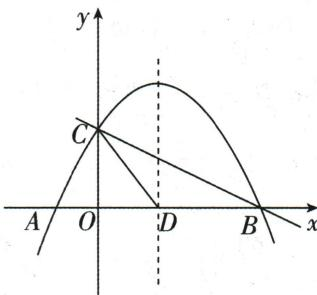

<!-- question-source:start -->
6 思想方法 数形结合 [难] 如图, 直线 $y = -\frac{1}{2}x + 2$ 与 x 轴交于点 B, 与 y 轴交于点 C. 已知二次函数的图象经过点 B, C 和点 A(-1,0).

(1) 求 B, C 两点的坐标.

(2)若抛物线的对称轴与 $x$ 轴交于点 $D$ , 则在抛物线的对称轴上是否存在一点 $N$ , 使 $\triangle NCD$ 为等腰三角形? 若存在, 求点 $N$ 的坐标; 若不存在, 请说明理由.

<!-- question-source:end -->

![[Q00106647A1]]
