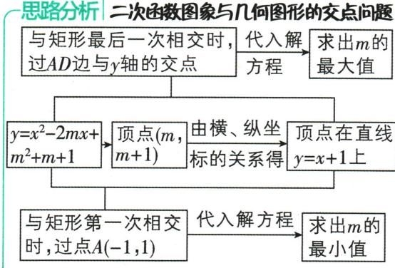
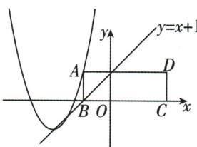
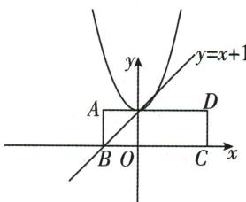

> [!success]- 必刷题
>
> > [!success] **【答案】** B
>
> > [!note]- **【解析】**
> > 
> > 【解析】将 $y=x^{2}-2mx+m^{2}+m+1$ 配成顶点式为 $y=(x-m)^{2}+m+1$ ，∴二次函数图象的顶点坐标是 $(m,m+1)$ 。∵ a=1>0，∴二次函数的图象开口向上，开口大小一定。∵顶点坐标为 $(m,m+1)$ ，∴此二次函数图象的顶点在直线 y=x+1 上。将抛物线沿直线 $y=x+1$ 从左至右移动，如图(1)，当二次函数的图象与矩形第一次相交时，二次函数的图象经过点 A(-1,1)，此时 m 取最小值。将 A(-1,1) 代入 $y=x^{2}-2mx+m^{2}+m+1$ 得 $1+2m+m^{2}+m+1=1$ ，解得 $m_{1}=\frac{-3-\sqrt{5}}{2}$ ， $m_{2}=\frac{-3+\sqrt{5}}{2}$ （舍去），则 m 的最小值是 $\frac{-3-\sqrt{5}}{2}$ 。如图(2)，当二次函数的图象与矩形最后一次相交时，二次函数的图象的顶点在 AD 边与 y 轴的交点 $(0,1)$ 处，此时 m 取最大值。将 $(0,1)$ 代入 $y=x^{2}-2mx+m^{2}+m+1$ 得 $m^{2}+m+1=1$ ，解得 $m_{1}=0$ ， $m_{2}=-1$ （舍去），∴ $\frac{-3-\sqrt{5}}{2}\leqslant m\leqslant0$ ，故选 B。
> >
> > 思路分析
> > 根据 A, B 关于抛物线对称轴对称, 可知 $x_{1} + x_{2} = 2$ . 由函数的性质, 数形结合的思想先求出 $x_{3}$ 的取值范围, 进而求出 t 的取值范围.
> >
> > 关键点拨
> > (1) 分别令 $y = -\frac{1}{2}x + 2$ 的 x = 0, y = 0，求出对应的 y 和 x 的值，即可得到点 C, B 的坐标.
> >
> > (2) 注意分类讨论, 并结合勾股定理和等腰三角形的性质求点 N 的坐标.
> >
> > 
> > 图(1)
> >
> > 
> > 图(2)
