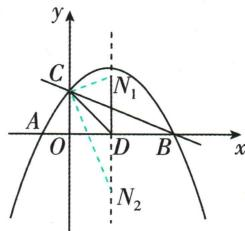
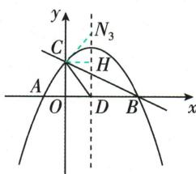
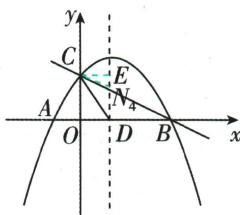

> [!success]- 必刷题
>
> > [!success] **【答案】** 详见解析
>
> > [!note]- **【解析】**
> > 【解】(1)对于直线 $y=-\frac{1}{2}x+2$ ，当 x=0 时，y=2；当 y=0 时，x=4，∴ $B(4,0)$ ， $C(0,2)$ .
> > (2) 存在.
> > ∵二次函数图象经过 $B(4,0)$ , $A(-1,0)$ ,
> > ∴对称轴为直线 $x=\frac{3}{2},\therefore D\left(\frac{3}{2},0\right)$ .
> > ∵ $C(0,2)$ , ∴ $CD = \sqrt{2^{2} + \left(\frac{3}{2}\right)^{2}} = \frac{5}{2}$ .
> > - **①**：当 DC = DN 时， $DN = \frac{5}{2}$ . 如图 (1)， $N_{1}\left(\frac{3}{2},\frac{5}{2}\right),N_{2}\left(\frac{3}{2},-\frac{5}{2}\right)$ .
> >
> > 
> > 图(1)
> >
> > 
> > 图(2)
> > - **②**：如图(2)，当 $CD = CN_{3}$ 时，过点 C 作 $CH \perp$
> >
> > $DN_{3}$ 于点 H. $\because CD = CN_{3}, CH \perp DN_{3}, \therefore DH = N_{3}H. \because C(0,2), \therefore DH = 2, \therefore N_{3}H = 2, \therefore N_{3}D = 4, \therefore N_{3}\left(\frac{3}{2}, 4\right).$
> > - **③**：如图（3），当 $N_{4}C = DN_{4}$ 时，过点 C 作 $CE \perp DN_{4}$ 交其延长线于点 E，则 $CE = \frac{3}{2}$ . 设 $DN_{4} = CN_{4} = t$ ，则 $EN_{4} = 2 - t$ .
> >
> > 
> > 图(3)
> >
> > $$
> > (2 -
> > $$
> >
> > $t)^{2}+\left(\frac{3}{2}\right)^{2}=t^{2}$ ，解得 $t=\frac{25}{16},\therefore N_{4}\left(\frac{3}{2},\frac{25}{16}\right)$ .
> > 综上所述，存在一点 N，使 $\triangle NCD$ 是等腰三角形，其坐标为 $\left(\frac{3}{2},\frac{5}{2}\right)$ 或 $\left(\frac{3}{2},-\frac{5}{2}\right)$ 或 $\left(\frac{3}{2},4\right)$ 或 $\left(\frac{3}{2},\frac{25}{16}\right)$ .
> >
> > ## 微专题
