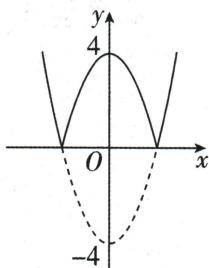

<!-- question-source:start -->
5 [2025 吉林四平期中] 如图, 将二次函数 $y = x^2 - 4$ 位于 $x$ 轴的下方的图象沿 $x$ 轴翻折, 得到一个新函数的图象 (实线部分). 当新函数中 $y$ 随 $x$ 的增大而增大时, 自变量 $x$ 的取值范围是 \_\_\_\_.

<!-- question-source:end -->

![[Q00106589A1]]
