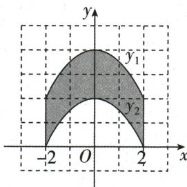

<!-- question-source:start -->
10[2025 广西玉林期末]如图, 已知抛物线 $y_{1} = -\frac{1}{2}x^{2} + 4 (-2 \leqslant x \leqslant 2)$ , 将抛物线 $y_{1}$ 向下平移 2 个单位长度后得到抛物线 $y_{2}$ , 则图中阴影部分的面积 S = \_\_\_\_.

<!-- question-source:end -->

![[Q00106594A1]]
