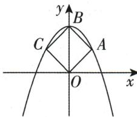

<!-- question-source:start -->
3[2024 广东中山期中, 中]如图, 抛物线 $y = ax^{2} + c$ 经过正方形 OABC 的三个顶点 A, B, C, 点 B 在 y 轴上, 则 ac 的值为
A. -1    B. -2    C. -3    D. -4

<!-- question-source:end -->

![[Q00106597A1]]
