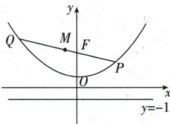

<!-- question-source:start -->
7 核心素养推理能力 [难] 如图, 已知点 P 是抛物线 $y = \frac{1}{8} x^{2} + 1$ 上的任意一点, 设点 P 到直线 y = -1 的距离为 $d_{1}$ , 点 P 到点 $F(0,3)$ 的距离为 $d_{2}$ .

(1) 求抛物线的顶点坐标和对称轴；

(2) 判断 $d_{1}, d_{2}$ 的大小关系并证明；

(3) 若线段 PF 的延长线交抛物线于点 Q，且线段 PQ 的长度是 m，线段 PQ 的中点 M 到 x 轴的距离是 n。直接写出 m 与 n 之间的函数关系式。

<!-- question-source:end -->

![[Q00106601A1]]
