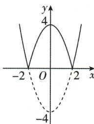

> [!success]- 必刷题
>
> > [!success] **【答案】** -2 < x < 0
>
> > [!note]- **【解析】**
> > ：将二次函数 $y = x^2 - 4$ 位于 $x$ 轴的下方的图象沿 $x$ 轴翻折，得
> >
> > ## 易错警示
> >
> > 到一个新函数的图象, ∴ 新函数的解析式为 $y = |x^{2} - 4|$ , ∴ 当 y = 0 时, $|x^{2} - 4| = 0$ , 解得 x = 2 或 -2. 如图, 当新函数中 y 随 x 的增大而增大时, 自变量 x 的取值范围是 -2 < x < 0 或 x > 2. 故答案为 -2 < x < 0
> >
> > 
> >
> > 二次函数 $y = ax^{2} + k$ 的增减性与一次函数增减性不同，它以对称轴 y 轴为界讨论增减性。在比较函数值时，若点没有在对称轴同一侧，应转化到同一侧再进行比较。
> >
> > x<0 或 x>2. 故答案为 -2<x<0 或 x>2.
