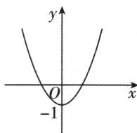

> [!success]- 必刷题
>
> > [!success] **【答案】** 详见解析
>
> > [!note]- **【解析】**
> > 【解】佳佳的判断错误,李华的判断正确.理再进行比较.
> >
> > 由:如图所示,说法①,若 $y_{1}=y_{2}$ ,则 $x_{1}=x_{2}$ 或 $x_{1}=-x_{2}$ ;说法②,若 $x_{1}=-x_{2}$ ,则 $y_{1}=y_{2}$ ;说法③,若 $0<x_{1}<x_{2}$ ,则在对称轴的右侧,y随x的增
> >
> > 
> >
> > 大而增大,则 $y_{1}<y_{2}$ ;说法④,若 $x_{1}<x_{2}<0$ ,则在对称轴的左侧,y随x的增大而减小,则 $y_{1}>y_{2}$ .故②④说法正确.
