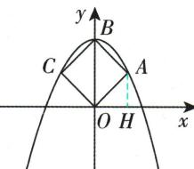

> [!success]- 必刷题
>
> > [!success] **【答案】** B
>
> > [!note]- **【解析】**
> > 过 A 作 $AH \perp x$ 轴于 H, 如图. ∵ 四边形 ABCO 是正方形, ∴ $\angle AOB = 45^{\circ}$ , ∴ $\angle AOH = 45^{\circ}$ , ∴ AH = OH. 设 $A(m, m)$ , 则 B(0,
> >
> > 
> >
> > $2m)$ ， $\therefore m = am^2 +c,2m = c,\therefore m = \frac{c}{2},am = -1$ ∴ac的值为-2，
> >
> > 故选 **B**.
