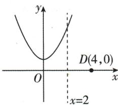
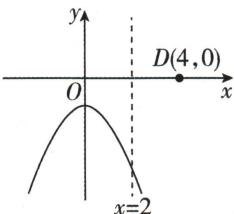

> [!success]- 必刷题
>
> > [!success] **【答案】** $\left(0, -\frac{2}{m}\right)$
>
> > [!note]- **【解析】**
> > (1) ∵ 抛物线 $y = mx^2 + \frac{2}{m}$ 与 $y$ 轴交于点 $A, \therefore A\left(0, \frac{2}{m}\right)$ . ∵ 点 $A$ 关于 $x$ 轴的对称点为点 $B, \therefore B\left(0, -\frac{2}{m}\right)$ , 故答案为 $\left(0, -\frac{2}{m}\right)$ .
> >
> > (2) $\because C\left(2, \frac{2}{m} - 1\right), \therefore$ 点 $C$ 在直线 $x = 2$ 上. 若线段 $CD$ 与抛物线恰有一个交点, 则分以下两种情况: 当 $m > 0$ 时, 如图 (1), $\frac{2}{m} - 1 \geqslant m \cdot 2^2 + \frac{2}{m}$ , 解得 $m \leqslant -\frac{1}{4}$ (舍去); 当 $m < 0$ 时, 如图 (2), $\frac{2}{m} - 1 \leqslant m \cdot 2^2 + \frac{2}{m}$ , 解得 $m \geqslant -\frac{1}{4}$ , 即 $-\frac{1}{4} \leqslant m < 0$ . 综上, $m$ 的取值范围为 $-\frac{1}{4} \leqslant m < 0$ .
> >
> > 
> >
> > 
> > 图(1)
> > 图(2)
