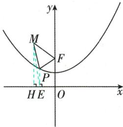

> [!success]- 必刷题
>
> > [!success] **【答案】** 5
>
> > [!note]- **【解析】**
> > 如图所示, 过点 M 作 $MH \perp x$ 轴于 H, 过点 P 作 $PE \perp x$ 轴于 E, 连接 ME. 由题意得 PE = PF. ∵ $M(-\sqrt{3}, 3)$ , $F(0, 2)$ , ∴ MH = 3, $MF = \sqrt{(-\sqrt{3} - 0)^{2} + (3 - 2)^{2}} = 2$ , ∴ $\triangle PMF$ 的
> >
> > 周长为 $PM + PF + MF = PM + PE + 2$ . ∵ MP + PE ≥ ME ≥ MH, ∴ 当 $MP \perp x$ 轴, 即 E 与 H 重合时, $MP + PE$ 的值最小, 最小值为 MH 的长, 即 3, ∴ $\triangle PMF$ 周长的
> >
> > 
> >
> > 思路分析
> > (2) 设 P 点坐标为 $\left(p, \frac{1}{8}p^{2} + 1\right)$ ，分别得出 $d_{1}^{2}$ 和 $d_{2}^{2}$ 的值，即可得出 $d_{1}, d_{2}$ 的大小关系.
> > (3)作 $QS \perp x$ 轴, $PR \perp x$ 轴, 取 RS 的中点 N, 连接 MN, 那么 MN 就是梯形 PRSQ 的中位线, 即 $2MN = PR + QS$ , 从而得到 m 与 n 之间的函数关系式.
> >
> > 最小值为 $3+2=5$ ，故答案为 5.
