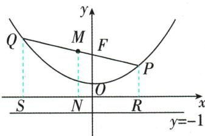

> [!success]- 必刷题
>
> > [!success] **【答案】** 详见解析
>
> > [!note]- **【解析】**
> > 【解】(1)∵抛物线的解析式为 $y=\frac{1}{8}x^{2}+1$ ,
> > ∴ 抛物线的顶点坐标是 $(0,1)$ ，对称轴为 y 轴.
> >
> > (2) $d_{1}=d_{2}$ . 证明: 设 $P\left(p,\frac{1}{8}p^{2}+1\right)$ ，则 $d_{1}^{2}=\left(\frac{1}{8}p^{2}+2\right)^{2}=\frac{p^{4}}{64}+\frac{p^{2}}{2}+4, d_{2}^{2}=p^{2}+\left(3-\frac{1}{8}p^{2}-1\right)^{2}=$ $\frac{p^{4}}{64}+\frac{p^{2}}{2}+4, \therefore d_{1}^{2}=d_{2}^{2}.$ $\because d_{1}>0, d_{2}>0, \therefore d_{1}=d_{2}.$ (3) $m=2n+2.$ 作 $QS\perp x$ 轴， $PR\perp x$ 轴，取 RS 的中点 N，连接 MN，如图. 同 (2) 可证得 QS=QF-1, PR=PF-1. 由梯形中位线得 2MN=QS+PR=QF-1+PF-1=QP-2，则 2n=m-2，所以 $m=2n+2.$
> >
> > 
> >
> > 课时2 二次函数 $y = a(x - h)^2$ 的图象和性质
