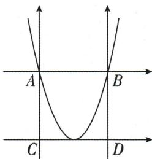

<!-- question-source:start -->
2[2025 浙江义乌质检]若小明将如图所示的两条水平线 AB, CD 中的一条当成 x 轴, 且向右为正方向; 两条铅垂线 AC, BD 中的一条当成 y 轴, 且向上为正方向, 并在此坐标平面中画出了二次函数 $y = 2(x - 1)^{2}$ 的图象, 则坐标原点可能是 ( )

A.点 $A$ B.点 $B$ C.点 $C$ D.点 $D$
<!-- question-source:end -->

![[Q00106603A1]]
