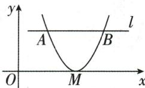

<!-- question-source:start -->
1[2025吉林松原期中,中]如图,抛物线 $y=(x-h)^{2}$ 与x轴只有一个交点M,且与平行于x轴的直线l交于A,B两点(A在B的左侧),若AB=3,则点M到直线l的距离是()

A. $\frac{7}{3}$ B. $\frac{9}{4}$ C. $\frac{11}{5}$ D. $\frac{13}{6}$
<!-- question-source:end -->

![[Q00106612A1]]
