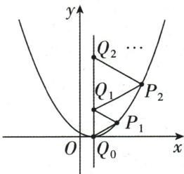

<!-- question-source:start -->
5[2024 山东德州期末,较难]如图,点 $P_{1}, P_{2}, P_{3}, \cdots, P_{n}$ 在抛物线 $y = a(x - 1)^{2}$ 上,点 $Q_{1}, Q_{2}, Q_{3}, \cdots, Q_{n}$ 在抛物线的对称轴上,若 $\triangle P_{1}Q_{0}Q_{1}, \triangle P_{2}Q_{1}Q_{2}, \cdots, \triangle P_{n}Q_{n-1}Q_{n}$ 都为等边三角形(点 $Q_{0}$ 是抛物线的顶点)且 $Q_{0}Q_{1} = 2$ ,则 $P_{n}$ 的坐标为 \_\_\_\_.

不愧是我鸭
<!-- question-source:end -->

![[Q00106616A1]]
