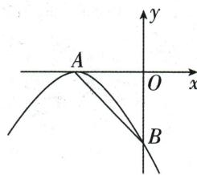

<!-- question-source:start -->
6[2025 广东广州校级期中, 中]如图, 抛物线 $y = a(x + 1)^{2}$ 的顶点为 A, 与 y 轴的负半轴交于点 B, 且 $S_{\triangle AOB} = \frac{1}{2}$ .

(1) 求抛物线的解析式;
(2) 若点 C 是该抛物线上 A, B 两点之间的一点
(点 C 不与点 A, B 重合), 当 $S_{\triangle ABC}$ 最大时, 求点 C 的坐标.

<!-- question-source:end -->

![[Q00106617A1]]
