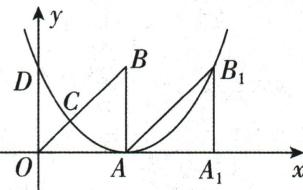

<!-- question-source:start -->
7 思想方法 方程思想 [较难] 如图, 在 Rt△OAB 中, ∠OAB=90°, O 为坐标原点, 边 OA 在 x 轴上, OA=AB=1, 现把△OAB 沿 x 轴的正方向平移 1 个单位长度后得△AA₁B₁.

(1) 求以 A 为顶点, 且经过点 $B_{1}$ 的抛物线的解析式;

(2) 若 (1) 中的抛物线与 $OB$ 交于点 $C$ , 与 $y$ 轴交于点 $D$ , 求点 $C, D$ 的坐标.

<!-- question-source:end -->

![[Q00106618A1]]
