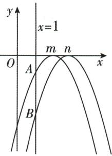
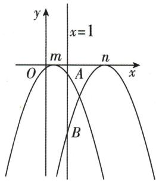
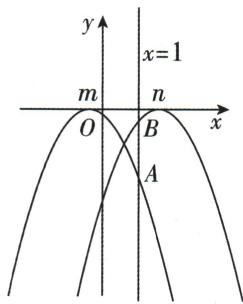
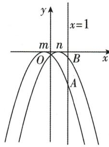

> [!success]- 必刷题
>
> > [!success] **【答案】** C
>
> > [!note]- **【解析】**
> > 如图(1)所示, 若 1<m<n, 则 $a_{1}>a_{2}$ , 故 A 选项错误; 如图(2)、图(3)所示, 若 m<1<n, 则 $a_{1}>a_{2}$ 或 $a_{1}<a_{2}$ , 故 B 选项错误; 如图(4)所示, 若 m<n<1, 则 $a_{1}<a_{2}$ , 故 C 选项正确, D 选项错误. 故选 C.
> >
> > 
> > 图(1)
> >
> > 
> > 图(2)
> >
> > 
> > 图(3)
> >
> > 
> > 图(4)
