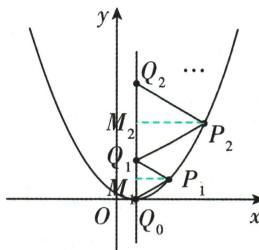

> [!success]- 必刷题
>
> > [!success] **【答案】** $(\sqrt{3}n+1,n^{2})$
>
> > [!note]- **【解析】**
> > 如图，过点 $P_1, P_2$ 作
> >
> > $P_{1}M_{1}\perp Q_{1}Q_{0},P_{2}M_{2}\perp$ $Q_{1}Q_{2}.\because$ 点 $Q_{1},Q_{2},$ $Q_{3},\cdots,Q_{n}$ 在抛物线 $y=a(x-1)^{2}$ 的对称轴上，对称轴为直线 x=1，则点 $Q_{1},Q_{2},Q_{3},\cdots,$
> >
> > 
> >
> > $Q_{n}$ 的横坐标为 1. ∵ $Q_{0}Q_{1}=2,\therefore Q_{0}M_{1}=\frac{1}{2}Q_{0}Q_{1}=1,M_{1}P_{1}=\sqrt{3},\therefore P_{1}(1+\sqrt{3},1)$ .
> > ∵ $P_{1}(1+\sqrt{3},1)$ 在抛物线 $y=a(x-1)^{2}$ 上，
> > ∴ $1=3a$ ，解得 $a=\frac{1}{3}$ ，∴ 抛物线解析式为 $y=\frac{1}{3}(x-1)^{2}$ . 设 $Q_{1}Q_{2}=m,\therefore Q_{1}M_{2}=\frac{m}{2},M_{2}P_{2}=\frac{\sqrt{3}}{2}m$ ，则 $P_{2}$ 的纵坐标为 $\frac{1}{2}m+2,P_{2}$ 的横坐标为 $\frac{\sqrt{3}}{2}m+1,\therefore\frac{1}{2}m+2=\frac{1}{3}\left(\frac{\sqrt{3}}{2}m+1-1\right)^{2}$ ，解得 m=-2（舍去）或 m=4，∴ $P_{2}$ 的纵坐标为 4, $P_{2}$ 的横坐标为 $\frac{\sqrt{3}}{2}\times4+1=2\sqrt{3}+1$ ，即 $P_{2}(2\sqrt{3}+1,4)$ 。∵点 $P_{1},P_{2},P_{3},\cdots,P_{n}$ 在抛物线 $y=\frac{1}{3}(x-1)^{2}$ 上，且在第一象限，∴横坐标与纵坐标满足 $x=\sqrt{3y}+1$ 。同理可得 $P_{3}$ 的纵坐标为9，横坐标为 $\sqrt{3\times9}+1=3\sqrt{3}+1,\cdots,P_{n}$ 的纵坐标为 $n^{2}$ ，横坐标为 $\sqrt{3\times n^{2}}+1=\sqrt{3}n+1,\therefore P_{n}(\sqrt{3}n+1,n^{2})$ ，故答案为 $(\sqrt{3}n+1,n^{2})$ 。
