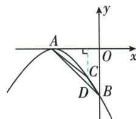

> [!success]- 必刷题
>
> > [!success] **【答案】** 详见解析
>
> > [!note]- **【解析】**
> > 【解】(1)由题易得 $A(-1,0), B(0,a), a<0$ , $\therefore OA=1, OB=-a$ . $\because S_{\triangle AOB}=\frac{1}{2}, \therefore \frac{1}{2} \times 1 \times (-a)=\frac{1}{2}$ , 解得 $a=-1$ , $\therefore$ 抛物线的解析式为 $y=-(x+1)^{2}$ .
> >
> > (2) $\because A(-1,0), B(0,-1), \therefore$ 易得 $AB$ 所在直
> >
> > 关键点按
> > 本题主要考查了根据函数图象和自变量的取值范围判断函数的最值问题,利用数形结合思想,根据函数图象得出函数的最值是解题的关键.
> >
> > 线的解析式为 y = -x - 1.
> > 如图, 过 C 作 x 轴的垂线,
> > 交 AB 于点 D. 设 $C(x, -(x+1)^{2})(-1<x<0)$ , 则 $D(x,-x-1), \therefore CD=$
> >
> > 
> >
> > $-(x+1)^{2}+x+1=-x^{2}-x.\because S_{\triangle ABC}=\frac{1}{2}(-x^{2}-x)\times$ $1=-\frac{1}{2}\left(x+\frac{1}{2}\right)^{2}+\frac{1}{8}.\because-\frac{1}{2}<0,\therefore$ 当 $x=-\frac{1}{2}$ 时, $S_{\triangle ABC}$ 最大,此时点C的坐标为 $\left(-\frac{1}{2},-\frac{1}{4}\right)$ .
