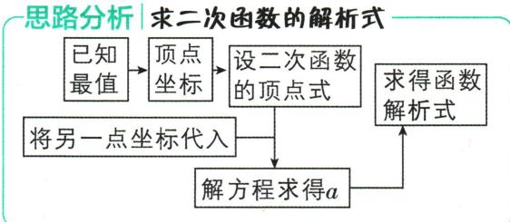

> [!success]- 必刷题
>
> > [!success] **【答案】** $y = {\left( x + 1\right) }^{2} + 2$ 
>
> > [!note]- **【解析】**
> > ∵ 当 x = -1 时, 函数的最小值为 2, ∴ 抛物线的顶点坐标为 $(-1, 2)$ . 设抛物线的解析式为 $y = a(x + 1)^{2} + 2$ . 把 $(1, 6)$ 代入 $y = a(x + 1)^{2} + 2$ , 得 $6 = 4a + 2$ , 解得 a = 1, ∴ 二次函数的解析式为 $y = (x + 1)^{2} + 2$ .
