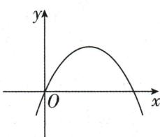
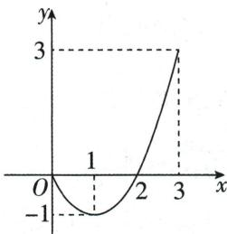

<!-- question-source:start -->
1[2025 山西吕梁质检]在平面直角坐标系中,若二次函数 $y=-(x-h)^{2}-k$ 的图象如图所示,则点 $(h,k)$ 所在的象限是
A. 第一象限 B. 第二象限
C. 第三象限 D. 第四象限

(第1题图)

(第2题图)
<!-- question-source:end -->

![[Q00106619A1]]
