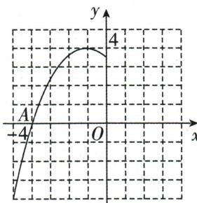

<!-- question-source:start -->
6[2024 河南周口期末]如图是二次函数 $y=a(x+1)^{2}+4$ 的图象的一部分(点 A 为抛物线与 x 轴的交点,且在网格线的交点处),根据图象回答下列问题:

(1) 确定 $a$ 的值;

(2) 设抛物线的顶点是 P, B 是 x 轴上的一个点, 若 $\triangle PAB$ 的面积为 6, 求点 B 的坐标.

<!-- question-source:end -->

![[Q00106624A1]]
