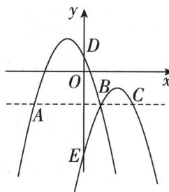

<!-- question-source:start -->
4[2024广西南宁校级质检,较难]如图,抛物线 $l_{1}:y_{1}=-(x+1)^{2}+2$ 与 $l_{2}:y_{2}=-(x-2)^{2}-1$ 交于点B(1,-2),且分别与y轴交于点D,E.过点B作x轴的平行线,交两条抛物线于点A,C,则以下结论:
①无论 x 取何值, $y_{2}$ 总是负数;
② $l_{2}$ 可由 $l_{1}$ 向右平移3个单位,再向下平移3个单位得到;

③随着 x 的增大, $y_{1}-y_{2}$ 的值先增大后减小;

④四边形 AECD 为正方形.

其中正确的是\_\_\_\_.(填序号)
<!-- question-source:end -->

![[Q00106631A1]]
