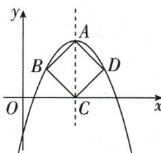

<!-- question-source:start -->
5 思想方法 数形结合 [较难] 如图, 抛物线 $y = a(x - h)^{2} + k (a < 0, k > 0)$ 的顶点为 A, 对称轴与 x 轴交于点 C, 当以 AC 为对角线的正方形 ABCD 的另外两个顶点 B, D 恰好在抛物线上时, 我们把这样的抛物线称为“美丽抛物线”, 正方形 ABCD 为它的内接正方形.

(1) 若抛物线 $y = ax^{2} + 2$ 是“美丽抛物线”，则 a = \_\_\_\_；

(2) 若抛物线 $y = -\frac{1}{2}(x - 1)^{2} + k$ 是“美丽抛物线”，则 k = \_\_\_\_；

(3) 若抛物线 $y = a(x - h)^{2} + k$ 是“美丽抛物线”，求 a, k 之间的数量关系.

<!-- question-source:end -->

![[Q00106632A1]]
