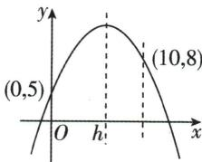

> [!success]- 必刷题
>
> > [!success] **【答案】** C
>
> > [!note]- **【解析】**
> > ∵ 二次函数 $y = a(x - h)^{2} + k$ , ∴ 抛物线的对称轴为直线 x = h. ∵ a < 0, ∴ 抛物线
> >
> > 开口向下. 如图, ∵ 图象经过 $(0,5)$ , $(10,8)$ 两点, 0 < h < 10, ∴ 5 < h < 10, 故结论 I 不正确. ∵ 图象经过 $(0,5)$ , $(10,8)$ 两
> >
> > 
> >
> > 点, $a < 0, 0 < h < 10$ , 对称轴为直线 $x = h$ , $\therefore$ 点 (10,8) 不是抛物线的顶点, 函数的最大值大于 8, $\therefore$ 当 $n = 8$ 时, 满足条件的点 $P$ 有两个, 故结论 II 正确.
> >
> > 故选 **C**.
